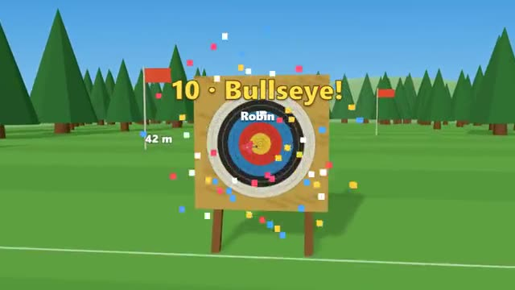

# Archery Range

Read the wind. Hit the gold. The target keeps moving back. A multiplayer starter game from [Multiplayer Agent](https://multiplayeragent.com): 3D, turn-based, 2–6 players, with bots that fill empty seats.

## How it plays

Take turns shooting at one target, three arrows a round, while everyone watches through your sight. The wind changes every arrow and the target moves back every round, from 18 to 70 metres. Highest total wins.

**Controls:** Press and hold to draw, drag to aim, let go to shoot (mouse or finger); or hold Space and use the arrow keys.

## Make it yours in the Game Builder

Open the [Game Builder](https://multiplayeragent.com), choose **Start from a starter game** and pick Archery Range. It opens as version 1 in your studio, ready to play and publish. Then ask for changes, for example:

- Add a moving target that slides left and right
- Make it a medieval castle tournament with banners
- Add a fire arrow you can use once per match for double points

## Run it yourself

1. Get a free publishable key (`pk_…`) at [multiplayeragent.com](https://multiplayeragent.com).
2. In `index.html`, put it in place of `pk_REPLACE_ME` in the `MP_CONNECT` block.
3. Serve the folder (for example `npx serve`) and open it. The 3D engine loads as a module, which browsers block from a file on disk.

Without a key it still runs, offline against bots.

## How it is built

- One `index.html` plus three.js in `libs/`. The comment at the top of the script maps the code and explains the multiplayer.
- The distances, wind, aim wobble and target are numbers in `CONFIG`. An arrow's flight is a formula of time, so every player's browser draws the same flight from one small shot record.
- **Leaderboard:** Each player's best total, shown on the results card.
- **Host-run rules:** The host's browser sets the wind, scores every arrow and runs the turns; if it leaves, the next player takes over.
- **Bots:** Bots shoot in the empty places, and take over for anyone who leaves.
- **Live sync:** Everyone watches each archer aim and follows every arrow to the target.
- `?attract` runs it offline with bots only. The preview video is recorded from it.

## License

MIT. three.js in `libs/` is MIT too (Copyright 2010-2024 three.js authors).
